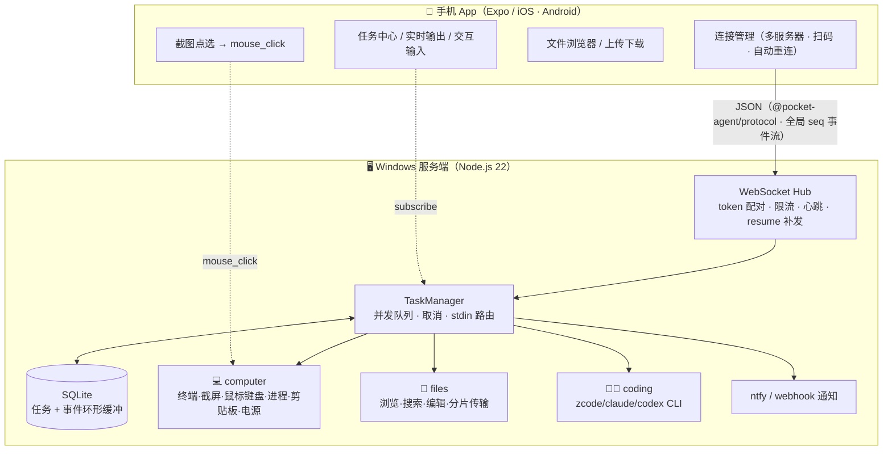

# Pocket Agent ⚡📱

**把整台 Windows 电脑装进手机：远程终端、AI 编码、文件传输、屏幕点选控制——全部通过一个 token 配对的连接完成。**

Pocket Agent turns your Windows PC into a fleet of remotely-drivable agents. From your phone you get an
interactive PowerShell terminal, AI coding sessions, file browsing/transfer, screenshots with
tap-to-click mouse control, process/clipboard/power management — over a token-paired WebSocket with
automatic reconnection and server-side task persistence.

## 它能做什么

| 能力 | 说明 |
| --- | --- |
| 🖥️ **远程终端** | 双向 PowerShell：手机上敲命令，输出实时回传，随时终止 |
| 🧑‍💻 **AI 编码** | 驱动 zcode / claude / codex 等 CLI 编码 agent 在项目目录干活，支持多轮交互 |
| 📁 **文件传输** | 浏览 / 搜索 / 编辑工作区文件，手机 ⇄ 电脑双向分片传输（sha256 校验） |
| 🖱️ **屏幕点选** | 截图回传手机，开启点选模式后「点哪里点哪里」，另有键盘输入 / 组合键 / 滚轮 |
| ⚙️ **系统管理** | 进程列表与结束、剪贴板读写、锁屏 / 睡眠 / 关机 / 重启 |
| 📋 **任务中心** | 所有任务在服务端排队执行并落库（SQLite）：历史、状态、断线重连自动补发事件流 |
| 🔔 **完成通知** | 任务在你没连着时完成，推送 ntfy / webhook 通知 |
| 📱 **扫码配对** | 服务端终端直接打印二维码，手机扫码即连（深链 `pocket-agent://connect?...`） |

## 架构



- **协议**（`packages/protocol`）：zod schema + TS 类型两端共享；每条 agent 事件带全局递增 `seq`。
- **断线不丢数据**：任务在服务端继续执行、事件落库；手机重连时带 `hello.since`（本地持久化的游标），服务端按 seq 补发错过的事件。服务重启后遗留任务标记 `interrupted`，历史可查。
- **多 Agent 插拔**：实现 `ServerAgent` 接口（`info` + `invoke` + 可选 `cancel`）注册即可，App 自动发现动作列表；长任务的输出流、取消、交互输入都是现成的。

## 目录结构

```
pocket-agent/
├── packages/protocol/     # WebSocket 协议（zod schema + 类型）
├── apps/server/           # Windows 服务端
│   ├── src/hub.ts         #   连接层：鉴权 / 限流 / 心跳 / resume
│   ├── src/task-manager.ts#   任务生命周期：队列 / 取消 / stdin / 通知
│   ├── src/store.ts       #   SQLite 持久层（better-sqlite3）
│   └── src/agents/        #   computer / files / coding
└── apps/mobile/           # 手机 App（Expo + React Native）
    └── src/screens/       #   连接 / 主页 / Agent 表单 / 任务中心 / 任务详情 / 文件
```

详细设计见 [ARCHITECTURE.md](ARCHITECTURE.md)。

## 快速开始

### 环境要求

- 电脑：Windows 10/11、Node.js ≥ 22、pnpm ≥ 10
- 手机：[Expo Go](https://expo.dev/go)（iOS / Android），与服务端**同一局域网**

### 1. 启动服务端

```bash
pnpm install
pnpm dev:server
```

终端会打印局域网地址、配对 token 和一张**配对二维码**：

```
  ⚡ Pocket Agent Server v0.2.0
  ──────────────────────────────────────────────
  局域网地址    ws://192.168.50.7:4310
  配对 token    3f9c2a…
  shell/控制类  关闭（设置 PA_ALLOW_SHELL=1 开启终端/鼠标键盘等）
  …
  手机 App 扫码配对（或手动输入上面的地址与 token）：
  ▄▄▄▄▄▄▄▄▄▄▄█▀▄█▀ ▀▀ ███▄▀ █ ▄█ ▄▄▄▄▄█
  …
```

> 首次启动如弹出 Windows 防火墙提示，请选择「允许」（专用网络）。

### 2. 连接手机

```bash
pnpm dev:mobile
```

用手机上的 Expo Go 扫终端二维码打开 App；再扫服务端打印的**配对二维码**（或手动输入地址 + token），点「连接」。连接信息会保存，下次自动重连。

### 3. 试试这些

- **远程终端**：Computer Agent → `run_command` → 打开「交互模式」→ 运行 → 在任务详情底部输入命令
- **AI 编码**：配置 coding agent（见下文）→ `run_task` 输入任务描述 → 实时看 agent 干活，`interactive` 可多轮追问
- **屏幕控制**：`screenshot` → 任务详情里打开「点选模式」→ 点截图任意位置即点击鼠标；配合 `key_type` / `key_tap` 可以完全远程操作
- **传文件**：文件 → 浏览目录 → 选文件可预览 / 编辑 / 下载到手机；右上角「上传」把手机文件传上来
- **挂机任务**：发起一个长任务后锁屏走人；任务在服务端继续跑，重连自动补发输出；没连着时完成会推 ntfy 通知

### 让 Coding Agent 跑起来

coding agent 不绑定具体工具，用「命令 + 参数模板」驱动任何 CLI 编码 agent。模板中的 `{{prompt}}` 会被替换为任务描述（spawn 不经 shell，无注入风险）：

```bash
PA_CODING_COMMAND=claude PA_CODING_ARGS='["-p","{{prompt}}"]' pnpm dev:server
```

### 任务完成通知（ntfy）

```bash
# 手机装 ntfy 应用并订阅一个 topic，服务端：
PA_NOTIFY_URL=https://ntfy.sh/my-secret-topic pnpm dev:server
```

无客户端连接时，任务完成/失败会推送到该 topic（也可用任何接收 POST 的 webhook）。

## 配置

优先级：环境变量 > `pocket-agent.json`（工作目录，已 gitignore）> 默认值。

| 环境变量 | 配置文件键 | 默认 | 说明 |
| --- | --- | --- | --- |
| `PA_PORT` | `port` | `4310` | WebSocket 端口 |
| `PA_HOST` | `host` | `0.0.0.0` | 监听地址 |
| `PA_TOKEN` | `token` | 每次随机 | 配对 token |
| `PA_WORKSPACE` | `workspace` | 当前目录 | files / coding 的工作区根（越界拒绝） |
| `PA_ALLOW_SHELL` | `allowShell` | 关闭 | `1` 开启终端 / 鼠标键盘 / 电源等控制类动作 |
| `PA_CODING_COMMAND` | `codingCommand` | 未配置 | coding agent 的 CLI 命令 |
| `PA_CODING_ARGS` | `codingArgs` | `["{{prompt}}"]` | 参数模板（JSON 数组） |
| `PA_DATA_DIR` | `dataDir` | `./data` | SQLite 数据目录 |
| `PA_MAX_CONCURRENT` | `maxConcurrent` | `3` | 并发任务上限，超出排队 |
| `PA_NOTIFY_URL` | `notifyUrl` | 关闭 | 任务完成通知（ntfy / webhook） |
| `PA_CANCEL_ON_DISCONNECT` | `cancelOnDisconnect` | 关闭 | 最后一个客户端断开时取消运行中任务 |

## 安全须知

- **token 是唯一身份凭证**；错误 token 的连接被立即关闭（`timingSafeEqual` 比较）。
- 终端、进程结束、鼠标键盘注入、电源动作都属于**控制类高危动作**，默认关闭，确认局域网可信后再开 `PA_ALLOW_SHELL=1`。截屏 / 剪贴板 / 进程列表属于信息暴露类，请自行权衡。
- files agent 的路径被限制在 `PA_WORKSPACE` 内（含上传 / 下载）；删除需显式 `confirm: true`；上传先写临时文件再原子改名。
- 每连接限流（突发 30、每秒补充 0.25）+ 服务端心跳（90s 无响应断开），防止失控客户端。
- 当前为**局域网明文 WebSocket**；公网使用请自备反向代理加 TLS（原生 wss 支持在 Roadmap）。

## 二次开发：新增一个 Agent

1. 在 `apps/server/src/agents/` 实现 `ServerAgent`：

```ts
export class MyAgent implements ServerAgent {
  readonly info: AgentInfo = {
    id: 'my-agent',
    name: '🔧 My Agent',
    description: '一句话说明它能干什么',
    actions: [{ name: 'do_thing', description: '动作说明' }],
  }

  async invoke(action: string, params: unknown, ctx: AgentContext & InvokeContext): Promise<void> {
    ctx.emit({ kind: 'started' })
    // 长任务：流式输出 + 支持取消 + 可选交互输入
    ctx.emit({ kind: 'output', stream: 'stdout', chunk: 'working…\n' })
    ctx.setInput((data) => { /* 写进程 stdin */ })   // 可选：交互式
    ctx.emit({ kind: 'completed', result: { hello: 'world' } })
  }

  cancel(requestId: string) { /* 尽力终止 */ }
}
```

2. 在 `registry.ts` 注册。
3. 没了——App 自动列出 agent 与动作，输出流 / 取消 / 任务历史 / 断线补发全部继承。

## 开发

```bash
pnpm typecheck   # 全 workspace 类型检查
pnpm smoke       # 端到端冒烟（13 组断言：配对/终端/传输/限流/断线补发/重启持久化…）
pnpm dev:server  # 启动服务端
pnpm dev:mobile  # 启动 Expo
```

CI（GitHub Actions）：ubuntu 跑 typecheck，windows 跑 smoke。

## Roadmap

- [ ] wss/TLS 与公网中继模式（frp/tailscale 场景文档先行）
- [ ] Agent 插件独立包（npm install 即挂载）
- [ ] 屏幕实时串流（当前为按需截图 + 点选）
- [ ] 多设备权限分级（只读 / 操作 / 管理）
- [ ] coding agent 会话恢复（服务重启后续跑 CLI）
- [ ] 任务定时触发与 webhook 触发

## License

[MIT](LICENSE) © ericbyz
