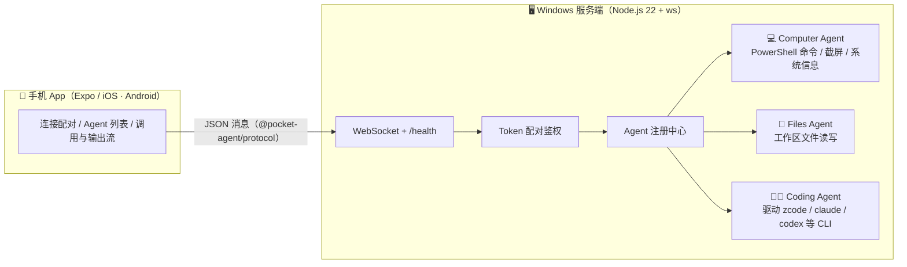

# Pocket Agent ⚡📱

**用手机驱动 Windows 电脑上的各种 Agent —— 写项目、跑命令、管文件、截屏，都在掌心完成。**

Control AI agents running on your Windows PC from your phone: coding tasks, shell commands,
files, screenshots — over a token-paired WebSocket connection.

服务端把电脑能力封装成一个个 **Agent**（命令执行、截屏、文件读写、编码 Agent……），手机 App 通过
**token 配对的 WebSocket** 连上服务端，就能在手机上触发任务、实时看到输出流、随时终止。

## 架构



- **协议**：`packages/protocol` 用 zod 定义全部消息（hello 配对、agent.invoke 调用、agent.event 事件流），
  服务端与手机端共享同一份 schema 与类型。
- **事件流**：长任务（跑命令、跑编码 agent）通过 `output` 事件把 stdout/stderr 实时推回手机，
  随时可以 `agent.cancel` 终止（Windows 下连子进程树一起杀）。
- **多 Agent 插拔**：实现一个 `ServerAgent` 接口并注册即可，App 端自动发现并列出动作。

## 目录结构

```
pocket-agent/
├── packages/protocol/     # 共享 WebSocket 协议（zod schema + 类型）
├── apps/server/           # Windows 服务端（Node.js 22 + ws）
│   └── src/agents/        #   computer / files / coding 三个内置 agent
└── apps/mobile/           # 手机 App（Expo + React Native，TypeScript）
```

## 快速开始

### 环境要求

- 电脑：Windows 10/11、Node.js ≥ 22、pnpm ≥ 10
- 手机：安装 [Expo Go](https://expo.dev/go)（iOS / Android 均可），与服务端**同一局域网**

### 1. 启动服务端

```bash
pnpm install
pnpm dev:server
```

启动后控制台会打印局域网地址和配对 token：

```
  ⚡ Pocket Agent Server v0.1.0
  ──────────────────────────────────────────────
  局域网地址    ws://192.168.1.8:4310
  本机地址      ws://127.0.0.1:4310
  配对 token    3f9c2a…（每次启动随机生成）
  工作区        D:\demo
  shell 执行    关闭（设置 PA_ALLOW_SHELL=1 开启）
  coding agent  未配置（可选，见下文）
```

> 首次启动如弹出 Windows 防火墙提示，请选择「允许」（专用网络）。

### 2. 连接手机

```bash
pnpm dev:mobile
```

用手机上的 Expo Go 扫终端二维码打开 App，把服务端打印的 **地址、端口、token** 填进去，点「连接」。

### 3. 试试这些

| 在 App 里 | 能做什么 |
| --- | --- |
| `computer.sysinfo` | 一键看主机名、CPU、内存、运行时长 |
| `computer.screenshot` | 截屏并在手机上直接预览 |
| `computer.run_command` | 远程执行 PowerShell 命令，输出实时回传（需 `PA_ALLOW_SHELL=1`） |
| `files.list / read / write` | 浏览和编辑服务端工作区里的文件（限制在 `PA_WORKSPACE` 内） |
| `coding.run_task` | 在项目目录里驱动 CLI 编码 agent 干活，输出实时回传（需配置，见下文） |

### 让 Coding Agent 跑起来

coding agent 不绑定具体工具，用一个「命令 + 参数模板」配置即可驱动任何 CLI 编码 agent
（zcode / claude / codex …）。参数模板中的 `{{prompt}}` 会被替换成你在手机上输入的任务描述：

```bash
# 例：驱动 claude CLI
PA_CODING_COMMAND=claude PA_CODING_ARGS='["-p","{{prompt}}"]' pnpm dev:server

# 例：驱动 zcode CLI
PA_CODING_COMMAND=zcode PA_CODING_ARGS='["-p","{{prompt}}"]' pnpm dev:server
```

命令通过 `spawn` 直接执行、不经过 shell，任务描述不会被解释成命令注入。

## 环境变量

| 变量 | 默认 | 说明 |
| --- | --- | --- |
| `PA_PORT` | `4310` | WebSocket 监听端口 |
| `PA_HOST` | `0.0.0.0` | 监听地址 |
| `PA_TOKEN` | 每次随机 | 配对 token；固定下来方便重连 |
| `PA_WORKSPACE` | 当前目录 | files / coding agent 的工作区根目录（越界访问会被拒绝） |
| `PA_ALLOW_SHELL` | 关闭 | `1` = 允许 `computer.run_command` 执行 PowerShell |
| `PA_CODING_COMMAND` | 未配置 | coding agent 的 CLI 命令 |
| `PA_CODING_ARGS` | `["{{prompt}}"]` | coding agent 的参数模板（JSON 数组） |

## 安全须知

- **token 是唯一的身份凭证**，只在不信任的对话者面前保密；错误 token 的连接会被立即关闭。
- `computer.run_command` 等于把电脑 shell 交到手机手里，**默认关闭**，确认局域网环境可信再开。
- files agent 的所有路径都被限制在 `PA_WORKSPACE` 内；删除操作要求显式 `confirm: true`。
- 当前连接是**局域网明文 WebSocket**，适合家庭/内网使用；公网访问请等 wss/TLS 支持（见 Roadmap）。

## 二次开发：新增一个 Agent

1. 在 `apps/server/src/agents/` 下实现 `ServerAgent` 接口（`info` 元数据 + `invoke`）：

```ts
export class MyAgent implements ServerAgent {
  readonly info: AgentInfo = {
    id: 'my-agent',
    name: '🔧 My Agent',
    description: '一句话说明它能干什么',
    actions: [{ name: 'do_thing', description: '动作说明' }],
  }

  async invoke(action: string, params: unknown, ctx: AgentContext & InvokeContext): Promise<void> {
    ctx.emit({ kind: 'started' })
    ctx.emit({ kind: 'completed', result: { hello: 'world' } })
  }
}
```

2. 在 `apps/server/src/agents/registry.ts` 注册。
3. 没了。手机 App 会自动列出这个 agent 和它的所有动作，长任务的 `output` 事件流、取消按钮也都是现成的。

协议消息定义见 [packages/protocol/src/index.ts](packages/protocol/src/index.ts)。

## 开发

```bash
pnpm typecheck   # 全 workspace 类型检查
pnpm smoke       # 服务端端到端冒烟测试（配对 → 调用 → 输出流 → 越权拒绝 → 坏 token 拒绝）
pnpm dev:server  # 启动服务端
pnpm dev:mobile  # 启动 Expo
```

CI（GitHub Actions）：ubuntu 上跑 typecheck，windows 上跑 smoke。

## Roadmap

- [ ] 扫二维码配对（免手输地址和 token）
- [ ] wss/TLS，以及内网穿透/中继模式（不在同一局域网也能连）
- [ ] Agent 插件 API：第三方 agent 独立包注册
- [ ] 屏幕实时串流与远程触控
- [ ] 文件双向传输（上传 / 大文件分块）
- [ ] 任务完成推送通知、多设备同时连接与权限分级

## License

[MIT](LICENSE) © ericbyz
